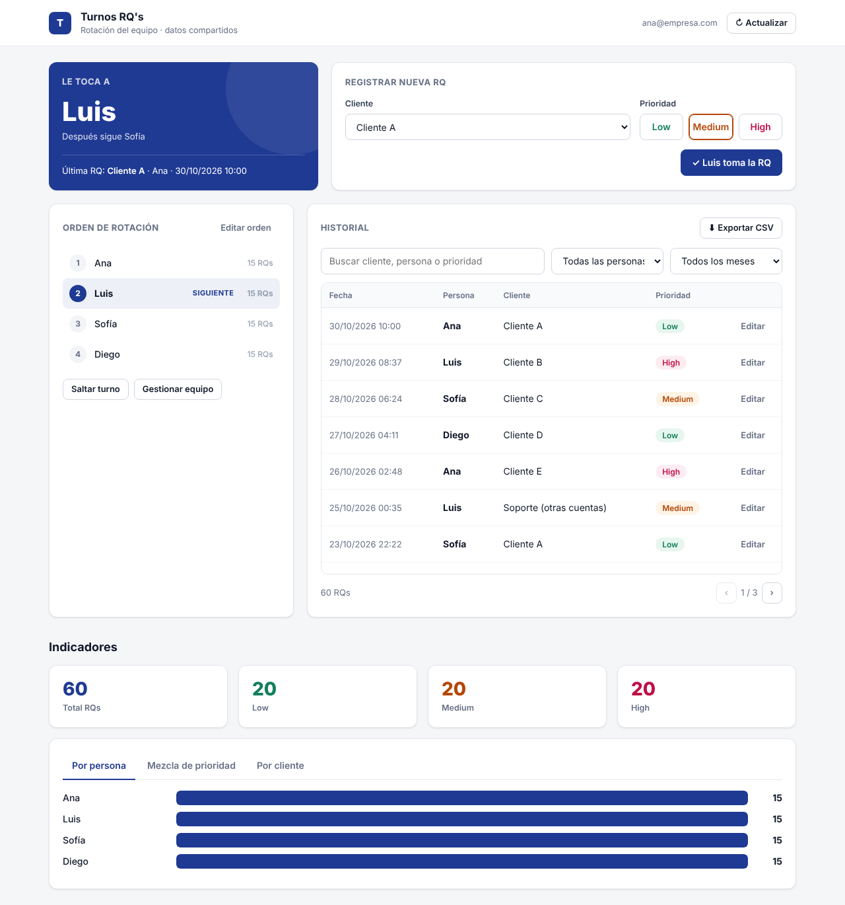

# Turnos RQ's — versión Google Apps Script

App web para repartir solicitudes (RQs) entre un equipo por turnos rotativos. Es la evolución de la app de Streamlit que está en la raíz de este repo: misma lógica, pero corre dentro de Google Workspace, sin servidores ni credenciales que administrar.



*Datos de ejemplo.*

## Qué hace

- Muestra a quién le toca y registra la RQ (cliente + prioridad) con un clic; el turno avanza solo.
- Orden de rotación editable, saltar turno, agregar y quitar personas sin perder el historial.
- Historial con búsqueda, filtros por persona y mes, paginación, corrección y borrado.
- Indicadores por persona, mezcla de prioridades y por cliente, filtrables por mes.
- Exportación a CSV.
- Solo entran cuentas del dominio configurado; cada RQ guarda quién la registró y quién la editó.
- Migración desde la versión Streamlit con respaldo automático y deducción del año en fechas sin año.

## Cómo está hecho

| Pieza | Detalle |
|---|---|
| Datos | Google Sheet con tres pestañas: `RQs`, `Estado`, `Config` |
| Servidor | `Code.gs`: API para la UI, `LockService` para evitar choques cuando dos personas registran a la vez, validación y control de acceso por dominio |
| Interfaz | `Index.html`: HTML/CSS/JS sin librerías, responsive, se repinta con el estado que devuelve cada llamada y se refresca cada 30 s |
| Configuración | Pestaña `Config` (clave/valor): nombre, color, clientes, prioridades y dominio, sin tocar código |
| Migración | `Migracion.gs`: lee el formato de Streamlit (`"29 oct 10:15"`), deduce el año y copia el estado de la rotación |

Como el script está vinculado a la hoja, copiar la hoja copia la app completa: así se reparte como plantilla a otros equipos.

## Instalación

Ver [PASO_A_PASO.md](PASO_A_PASO.md).

## Desarrollo local

No hace falta para usarla, pero para editar desde el computador se puede usar [clasp](https://github.com/google/clasp):

```bash
npm i -g @google/clasp
clasp login
clasp clone <SCRIPT_ID> --rootDir apps-script
clasp push
```
