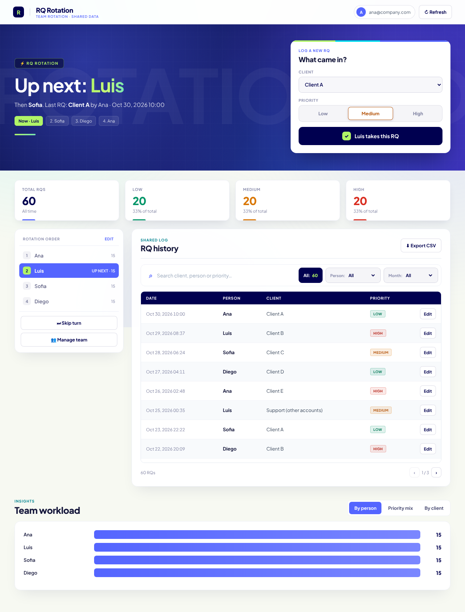

# RQ Rotation — Google Apps Script version

Web app that hands out incoming requests (RQs) to a team in a round-robin rotation. It's the evolution of the Streamlit app at the root of this repo: same logic, but it runs inside Google Workspace with no servers or credentials to manage.



*Sample data.*

## What it does

- Shows whose turn it is and logs the RQ (client + priority) in one click; the turn advances automatically.
- Editable rotation order, skip turn, add and remove people without losing history.
- History with search, filters by person and month, pagination, editing and deletion.
- Insights by person, priority mix and client, filterable by month.
- CSV export.
- Only accounts from the configured domain can get in; each RQ records who logged it and who edited it.
- Migration from the Streamlit version with an automatic backup and year inference for dates stored without a year.

## How it's built

| Piece | Details |
|---|---|
| Data | Google Sheet with three tabs: `RQs`, `State`, `Config` |
| Server | `Code.gs`: API for the UI, `LockService` to avoid collisions when two people log at the same time, validation and domain-based access control |
| Interface | `Index.html`: HTML/CSS/JS with no libraries, responsive, repaints from the state each call returns and refreshes every 30 s |
| Brand | `Brand.html`: font and logo isolated in one file, so the brand can change without touching the interface |
| Config | `Config` tab (key/value): name, subtitle, clients, priorities and domain, no code changes needed |
| Migration | `Migration.gs`: reads the Streamlit format (`"29 oct 10:15"`), infers the year and copies the rotation state |

Because the script is bound to the sheet, copying the sheet copies the whole app: that's how it's shared as a template with other teams.

## Setup

See [SETUP_GUIDE.md](SETUP_GUIDE.md).

## Local development

Not needed to use it, but to edit from your computer you can use [clasp](https://github.com/google/clasp):

```bash
npm i -g @google/clasp
clasp login
clasp clone <SCRIPT_ID> --rootDir apps-script
clasp push
```
